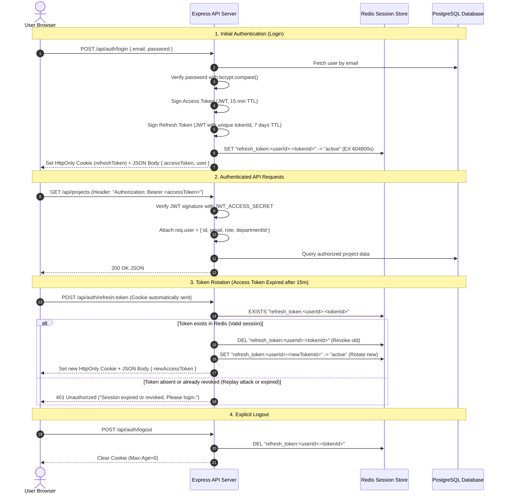

# Authentication & Role-Based Access Control (RBAC) Architecture Guide

This comprehensive reference explains the authentication lifecycle, cryptographic hashing, JWT mechanics, Redis session management, and role-based access control implemented in the **Student Project Lifecycle Management Platform (SPLM)**.

---

## 1. Authentication vs. Authorization

| Concept | Question Answered | Implementation in SPLM |
| :--- | :--- | :--- |
| **Authentication (AuthN)** | *"Who are you?"* | Validating institutional email and password hash via bcrypt, and verifying signed JWT access tokens on incoming HTTP requests. |
| **Authorization (AuthZ)** | *"What are you allowed to do?"* | Inspecting the authenticated user's `role` (`STUDENT`, `FACULTY`, `ADMIN`) and resource ownership (`project_members`, `submitted_by`) to determine if the requested action is permitted. |

---

## 2. Password Security: Bcrypt Hashing

### 2.1 Why Plaintext or Fast Hashes (MD5, SHA-256) Must Never Be Used
- **MD5 and SHA-256 are general-purpose cryptographic hashes**: They are engineered to be extremely fast (billions of hashes per second on modern GPUs). An attacker who obtains a database leak can brute-force billions of candidate passwords per second using precomputed rainbow tables.
- **Bcrypt is an adaptive, slow key-derivation function**:
  1. **Salt**: Generates a cryptographically random 16-byte salt per user. Salting guarantees that two users with the identical password `"Password@123"` have completely different hashes, neutralizing rainbow table attacks.
  2. **Work Factor (Cost = 10 rounds)**: Bcrypt performs $2^{10} = 1024$ internal iterations. This intentionally slows down hash computation (~100ms per attempt), making brute-force dictionary attacks computationally prohibitive for attackers while remaining imperceptible to a human logging in.

---

## 3. Two-Token Architecture: Access Token + Refresh Token



---

## 4. Where Should Tokens Be Stored?

| Storage Mechanism | Vulnerability | Verdict in SPLM |
| :--- | :--- | :--- |
| **`localStorage`** | Accessible to any JavaScript code running on the page. Completely vulnerable to **Cross-Site Scripting (XSS)** token theft. | ❌ **Rejected for Refresh Tokens**. |
| **JavaScript Memory (React State / Context)** | Lost on page refresh unless re-fetched; inaccessible to XSS scripts unless they execute inside the active React lifecycle. |  **Used for short-lived Access Tokens (15 min)**. |
| **`HttpOnly`, `SameSite=Strict`, `Secure` Cookie** | Browser blocks client-side JavaScript (`document.cookie`) from reading the cookie. `SameSite=Strict` prevents Cross-Site Request Forgery (CSRF). |  **Used for long-lived Refresh Tokens (7 days)**. |

---

## 5. The Authoritative Redis Refresh Token Store

### Why Redis Session Store is Superior to Dual Whitelist/Blacklist
- In naive implementations, developers maintain both a database whitelist table and a Redis blacklist set. This creates database write overhead and synchronization issues.
- In SPLM, **Redis is the Authoritative Store**:
  - Key format: `refresh_token:<userId>:<tokenId>`
  - The presence of the key in Redis **is** the authorization to refresh.
  - When the user logs out, we execute `DEL refresh_token:<userId>:<tokenId>`. Instant \(O(1)\) revocation without database queries.
  - If a stolen refresh token is used after rotation, the old `tokenId` no longer exists in Redis, immediately blocking replay attacks with `401 Unauthorized`.

---

## 6. Role-Based Access Control (RBAC) Implementation

Authorization is enforced at the network boundary through Express middleware:

```typescript
// backend/src/middleware/auth.middleware.ts
export const requireRole = (allowedRoles: UserRole[]) => {
  return (req: Request, res: Response, next: NextFunction): void => {
    if (!req.user) throw ApiError.unauthorized();
    if (!allowedRoles.includes(req.user.role)) {
      throw ApiError.forbidden(`Access denied: Requires [${allowedRoles.join(', ')}]`);
    }
    next();
  };
};
```

### Why Frontend UI Hiding Is NEVER Sufficient
Hiding an "Approve Proposal" button in the React UI only prevents ordinary clicks. Any user can open DevTools or execute `curl -X POST /api/proposals/123/approve`. 
**Security must always be enforced on the backend.** Every API endpoint verifies the cryptographic JWT and inspects `req.user.role` before executing any database operation.
