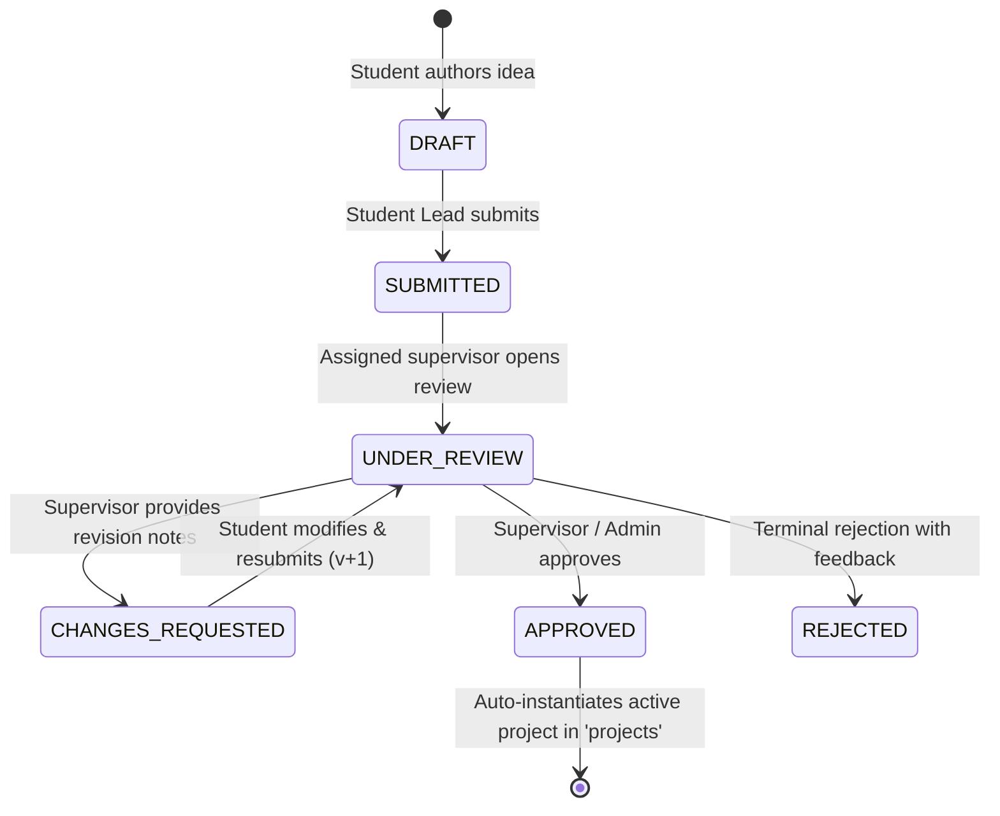

# Stage 7 Guide: Project Proposal Lifecycle, Faculty Appraisal & Relational Auto-Instantiation

## 1. Concepts & Engineering Principles

### 1.1 The Academic Proposal Lifecycle State Machine
In tertiary engineering education, an accredited capstone project is not simply created on demand. It must traverse a rigorous institutional appraisal process before faculty supervisors are formally assigned, laboratory equipment/cloud compute credits are allocated, and examination boards are scheduled.

The proposal follows a deterministic Finite State Machine (FSM):



### 1.2 Separation of Concerns: Proposals vs Projects
A common architectural anti-pattern in academic software is having a single `projects` table with a nullable `status` column containing `['DRAFT', 'SUBMITTED', 'ACTIVE', 'COMPLETED']`. This causes several major issues:
1. **Sparse Nullable Columns**: During the proposal phase, fields like `evaluation_marks`, `repository_url`, `final_thesis_document`, and `defense_date` are meaningless and null.
2. **Polluted Analytical Queries**: Institutional queries such as `SELECT COUNT(*) FROM projects WHERE status = 'IN_PROGRESS'` must continually guard against unapproved drafts, abandoned ideas, and rejected proposals.
3. **Immutability of Historical Proposals**: Once a proposal is approved, it becomes an official historical record (`proposals`). The operational execution then proceeds independently in `projects`.

### 1.3 Atomic Project Auto-Instantiation Engine
When a proposal reaches the `APPROVED` state, human re-entry of data across different administrative forms introduces transcription errors and delay.
To solve this, Stage 7 implements a PostgreSQL ACID transaction that atomically executes:
1. Updates `proposals.status = 'APPROVED'`.
2. Inserts a row into `projects` (`status = 'ALLOCATED'`, `overall_progress = 0`).
3. Transposes all confirmed (`ACCEPTED`) rows from `proposal_members` into `project_members`, designating the author as `role_in_project = 'LEAD'` and invited peers as `'MEMBER'`.
4. Pre-populates the 5 standard accreditation milestone gates in `milestones`:
   - M1: *Requirement Analysis & Literature Review* (Day 0 to +30)
   - M2: *System Architecture & Detailed Design* (Day +30 to +60)
   - M3: *Core Module Implementation & Integration* (Day +60 to +105)
   - M4: *Testing, Benchmarking & Performance Optimization* (Day +105 to +135)
   - M5: *Final Thesis Documentation & Viva Defense* (Day +135 to +160)
5. Appends an audit entry into `audit_logs` tracking the evaluator ID, timestamp, and metadata.

If any milestone insertion or member transposition fails (e.g., due to a constraint or network hiccup), the entire transaction rolls back (`ROLLBACK`), leaving the database in a completely uncorrupted state.

### 1.4 Configurable Constraints (Zero Hardcoding)
Hardcoding constants such as `MAX_TEAM_SIZE = 4` violates academic extensibility. In our platform, constraints are loaded dynamically from `system_settings`:
- `MAX_TEAM_SIZE`: Maximum allowable student members per project team (default 4).
- `MIN_TEAM_SIZE`: Minimum confirmed members required before submission (default 1).
- `ALLOW_STUDENT_PROPOSALS`: System-wide emergency switch allowing or freezing new submissions.

---

## 2. API Specifications & Data Contracts

### 2.1 Author Proposal (DRAFT or SUBMITTED)
- **Endpoint**: `POST /api/proposals`
- **Authorization**: `STUDENT` role required.
- **Request Body**:
```json
{
  "title": "Multimodal Foundation Model for Rare Pathology Detection",
  "abstract": "Investigating zero-shot vision-language alignment architectures for microscopic histology image analysis across rare oncological subtypes.",
  "domain": "Multimodal AI & Healthcare",
  "techStack": ["PyTorch", "CLIP", "BioBERT", "FastAPI", "React"],
  "assignedFacultyId": "f0000000-0000-0000-0000-000000000002",
  "initialStatus": "DRAFT",
  "coMemberStudentIds": ["b0000000-0000-0000-0000-000000000003"]
}
```
- **Response**: `201 Created` with full `ProposalDetailDto`.

### 2.2 Invite Team Member
- **Endpoint**: `POST /api/proposals/:id/members`
- **Authorization**: Student Team Lead only.
- **Request Body**:
```json
{
  "studentId": "b0000000-0000-0000-0000-000000000004"
}
```

### 2.3 Respond to Team Invitation
- **Endpoint**: `PATCH /api/proposals/:id/members/respond`
- **Authorization**: Invited student only.
- **Request Body**:
```json
{
  "status": "ACCEPTED"
}
```

### 2.4 Faculty Appraisal & Project Instantiation
- **Endpoint**: `POST /api/proposals/:id/review`
- **Authorization**: `FACULTY` or `ADMIN` role required.
- **Request Body**:
```json
{
  "status": "APPROVED",
  "facultyComments": "Strong research foundation with clear clinical relevance. Approved for active capstone execution."
}
```
- **Response**: `200 OK`
```json
{
  "success": true,
  "message": "Proposal approved and official project instantiated successfully",
  "data": {
    "proposal": {
      "id": "c42c0a3a-98d7-40db-b95e-d1bc5d486c93",
      "status": "APPROVED",
      "version": 2
    },
    "instantiatedProjectId": "f97e6087-c77a-4c8f-8a7b-f0ad78a39884"
  }
}
```

---

## 3. Review Checkpoint Quiz (Viva & Defense Preparation)

### Question 1: What is the benefit of using an ACID transaction during proposal approval?
**Answer**: Proposal approval triggers multi-table operations: updating `proposals.status`, creating a row in `projects`, copying rows from `proposal_members` to `project_members`, creating 5 milestone gates in `milestones`, and logging into `audit_logs`. Without a transaction, if milestone creation fails midway (e.g. server crash or disk full), the proposal would be marked approved and the project created, but with no milestones or team members attached—leaving the platform in an inconsistent "half-created" state. PostgreSQL transactions guarantee that all 5 steps either succeed together (`COMMIT`) or fail together (`ROLLBACK`).

### Question 2: Why do proposals have a `version` integer, and when does it increment?
**Answer**: Academic project proposals often require revisions following faculty feedback. When a supervisor issues `CHANGES_REQUESTED`, the proposal remains in an editable state. When the student team modifies the abstract/methodology and resubmits, the backend increments `version = version + 1`. This allows the supervisor and departmental committees to audit how many revision rounds were required and track the evolution of the proposal.

### Question 3: How does the system prevent faculty overloading when approving a proposal?
**Answer**: Before committing the approval transaction, the service queries the `faculty` table for the supervisor's `max_projects` limit and counts their current non-completed projects (`SELECT COUNT(id) FROM projects WHERE faculty_guide_id = $1 AND status NOT IN ('COMPLETED', 'ARCHIVED')`). If the supervisor's active project count already meets or exceeds `max_projects`, the approval is rejected with an explanatory `ApiError.badRequest(...)`, preventing faculty burnout and ensuring equitable distribution of supervision duties.

### Question 4: How are team members represented differently in proposals versus active projects?
**Answer**: In the proposal phase, membership is prospective: prospective peers have invitations in `proposal_members` with statuses `'INVITED'`, `'ACCEPTED'`, or `'DECLINED'`. Members can decline or be removed. Once the proposal is approved, only the members with `'ACCEPTED'` status are transposed to `project_members`, where their formal academic roles (`'LEAD'` for the proposal author and `'MEMBER'` for peers) become part of the official, accredited project roster.
